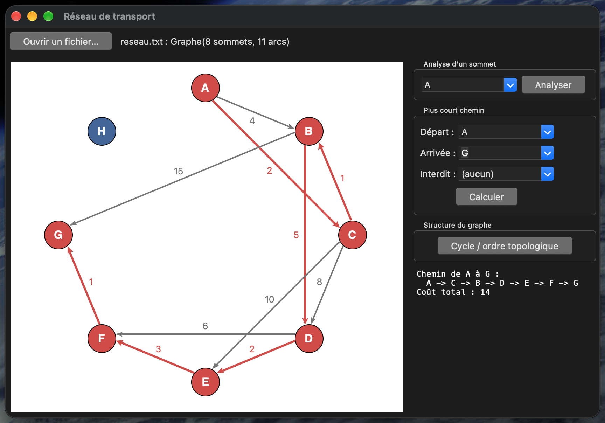
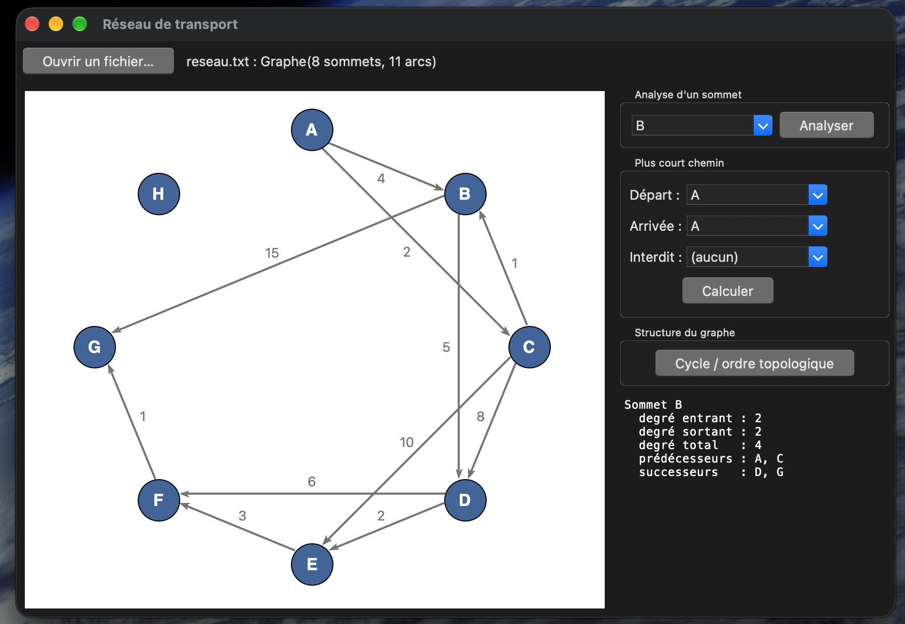
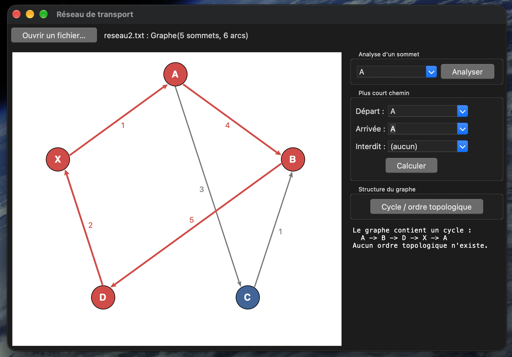

# Projet Python : concevoir et analyser un réseau de transport

Projet individuel noté (POO, théorie des graphes, fichiers, algorithmique, tests).
Un réseau de lieux est modélisé par un **graphe orienté pondéré** G = (V, E) ; l'application
permet de le construire, de le charger depuis un fichier, de l'analyser et de chercher des itinéraires.
Le sujet complet est dans [`sujet/projet.md`](sujet/projet.md).
Le rapport est dans [`rapport.pdf`](rapport.pdf) (source : [`rapport.md`](rapport.md)).

## Environnement

- **Python** : testé en local avec Python 3.15 et en intégration continue avec Python 3.15
  (tout Python ≥ 3.7 convient, l'ordre d'insertion des `dict` étant utilisé).
- **Installation** : aucune avec pip. Seule la bibliothèque standard est utilisée (aucune bibliothèque
  de graphes) ; `requirements.txt` ne contient donc que des commentaires.
- **Tkinter** (uniquement pour l'interface graphique) : il fait partie de la bibliothèque standard, mais
  certaines installations de Python le fournissent à part, et il ne s'installe pas avec pip :
  - macOS (Homebrew) : `brew install python-tk@3.15` (adapter à la version de Python) ;
  - Debian / Ubuntu : `sudo apt install python3-tk` ;
  - Windows (Python de python.org) : inclus par défaut.

  Vérification : `python3 -m tkinter` ouvre une petite fenêtre de test.
- **Lancer l'interface graphique** (depuis la racine du projet) :

```bash
python3 interface.py
```

- **Lancer la démonstration** en ligne de commande (depuis n'importe quel dossier) ; elle enchaîne
  des exemples pour chaque partie (A à F, robustesse de la lecture), et sa sortie est enregistrée
  dans `exemples_execution.txt` :

```bash
python3 demo.py
python3 demo.py > exemples_execution.txt   # régénérer le fichier d'exemples
```

- **Lancer les tests** (depuis la racine du projet) :

```bash
python3 -m unittest discover -s tests -v          # tous les tests
python3 -m unittest tests.test_itineraire -v      # uniquement la partie D
python3 -m unittest tests.test_contraintes -v     # uniquement la partie E
python3 -m unittest tests.test_cycles -v          # uniquement la partie F (bonus)
```

- **Sans interface** : les fonctionnalités s'essaient aussi dans l'interpréteur, lancé à la racine du projet :

```python
>>> from graphe import Graphe
>>> g = Graphe.from_file("data/reseau.txt")
>>> g.shortest_path("A", "G")
(['A', 'C', 'B', 'D', 'E', 'F', 'G'], 14)
>>> g.shortest_path("A", "H")      # H est isolé : aucun chemin
([], inf)
>>> g.shortest_path("A", "A")      # départ = arrivée
(['A'], 0)
>>> g.shortest_path_avoiding("A", "G", "C")
(['A', 'B', 'D', 'E', 'F', 'G'], 15)
>>> g.shortest_path_avoiding("A", "G", "G")   # interdit = arrivée : impossible
([], inf)
>>> g.intersection(Graphe.from_file("data/reseau2.txt")).arcs_en_triplets()
[('A', 'B', 4), ('B', 'D', 5), ('C', 'B', 1)]
>>> g.has_cycle()
False
>>> g.topological_sort()
['A', 'H', 'C', 'B', 'D', 'E', 'F', 'G']
>>> g2 = Graphe.from_file("data/reseau2.txt")
>>> g2.has_cycle(), g2.trouver_cycle()
(True, ['A', 'B', 'D', 'X', 'A'])
>>> g2.topological_sort()
Traceback (most recent call last):
  ...
graphe.exceptions.GrapheCycliqueError: Aucun ordre topologique : le graphe contient un cycle (A -> B -> D -> X -> A).
```

## Structure du projet

```
graphe/             paquet principal
  sommet.py         classe Sommet (identifiant textuel unique, non vide)
  arc.py            classe Arc (origine, destination, poids >= 0)
  graphe.py         classe Graphe (sommets + liste d'adjacence, analyse, Dijkstra, sommet interdit,
                    intersection, détection de cycle, tri topologique)
  lecture.py        lecture d'un graphe depuis un fichier texte (`Graphe.from_file`)
  exceptions.py     hiérarchie d'exceptions personnalisées
interface.py        interface graphique Tkinter de démonstration
demo.py             démonstration en ligne de commande des principales fonctionnalités
exemples_execution.txt  sortie de `python3 demo.py` (exemples d'exécution)
captures/           captures d'écran de l'interface (utilisées dans le rapport)
rapport.md          source Markdown du rapport
rapport.pdf         rapport PDF (2 à 4 pages)
requirements.txt    aucune dépendance pip (instructions pour Tkinter)
data/reseau.txt     réseau du sujet (8 sommets, 11 arcs, H isolé)
data/reseau2.txt    second graphe de test (5 sommets, 6 arcs, contient le cycle A -> B -> D -> X -> A)
tests/              tests unittest (test_graphe, test_lecture, test_analyse, test_itineraire,
                    test_contraintes, test_cycles)
sujet/              énoncé
```

## Avancement

| Partie | Contenu | État |
|---|---|---|
| A | Modélisation orientée objet | ✅ Terminée |
| B | Lecture de fichier (`from_file`) et robustesse | ✅ Terminée |
| C | Analyse : degrés, prédécesseurs, successeurs | ✅ Terminée |
| D | Plus court chemin (`shortest_path`, Dijkstra) | ✅ Terminée |
| E | Sommet interdit et intersection de graphes | ✅ Terminée |
| F | Bonus : détection de cycle **et** tri topologique (les deux options) | ✅ Terminée |
| Tests | 8 tests minimum | ✅ 109 tests pour les parties A à F |
| Livrables | Rapport PDF (2 à 4 pages), exemples d'exécution, second graphe de test | ✅ Terminée : second graphe (`data/reseau2.txt`), exemples d'exécution (`demo.py`, `exemples_execution.txt`), interface (`interface.py`) et captures (`captures/`), rapport PDF (`rapport.pdf`) |

### Partie A (réalisée)

- **Classes** : `Graphe` (gère sommets et arcs), `Sommet` et `Arc` (objets valeurs),
  plus des exceptions dérivées de `GrapheError` : `IdentifiantInvalideError`,
  `SommetExistantError`, `SommetInconnuError`, `ArcExistantError`, `PoidsInvalideError`.
- **Méthodes** : `ajouter_sommet`, `ajouter_arc`, `sommets`, `arcs`, `arcs_en_triplets`,
  `get_sommet`, `get_arc`, `contient_sommet`, `contient_arc`, `nombre_sommets`, `nombre_arcs`,
  `len(g)`, `"A" in g`, `repr` et `str` (affichage lisible, un sommet par ligne avec ses successeurs).
- **Règles de gestion appliquées** :
  - identifiant de sommet textuel, non vide et unique ;
  - poids numérique et ≥ 0 (nécessaire pour Dijkstra) ;
  - extrémités d'un arc déjà présentes dans le graphe ;
  - arcs multiples interdits : le doublon se juge sur le couple (origine, destination), quel que soit le poids ;
  - `A → B` n'implique pas `B → A` ;
  - un sommet isolé est valide.
- **Séparation traitements / affichage** : aucune méthode n'appelle `input()` ni `print()` ;
  elles retournent des valeurs ou lèvent des exceptions.

### Partie B (réalisée)

- **Méthode** : `Graphe.from_file(chemin)` (chemin en `str` ou `Path`), qui s'appuie sur
  `lire_graphe` dans `graphe/lecture.py`.
- **Format** : première ligne utile `Sommets: A, B, C`, puis une ligne par arc `origine;destination;poids`.
  Les lignes vides et celles commençant par `#` sont ignorées ; les espaces autour des valeurs sont tolérés.
- **Politique d'erreur** : le fichier est **rejeté en entier** à la première erreur, car un réseau
  chargé à moitié pourrait donner de faux itinéraires. L'exception porte le numéro et le contenu de la ligne fautive.
- **Exceptions** : `FichierIntrouvableError` (fichier absent, hérite aussi de `FileNotFoundError`),
  `FichierGrapheError` (fichier illisible : dossier, droits), `FormatFichierError` (contenu invalide,
  avec `numero_ligne` et la cause d'origine en `__cause__`), `LigneMalFormeeError` (ligne mal structurée),
  en plus des erreurs de la partie A (doublon, sommet inconnu, poids invalide) qui sont réutilisées.

### Partie C (réalisée)

- **Méthodes de `Graphe`** : `successeurs`, `predecesseurs`, `degre_entrant`, `degre_sortant`,
  `degre_total`, `est_isole`, `analyser_sommet` (dictionnaire regroupant toutes ces informations).
- Un sommet inconnu lève `SommetInconnuError`.
- Les listes retournées sont des copies : les modifier ne modifie pas le graphe.

### Partie D (réalisée)

- **Méthode** : `shortest_path(depart, arrivee)` retourne un tuple `(chemin, cout)` :
  la liste des sommets de `depart` à `arrivee` inclus, et la somme des poids.
- **Cas particuliers** :
  - départ = arrivée : `(["A"], 0)` (chemin trivial, y compris pour le sommet isolé H) ;
  - aucun chemin : `([], math.inf)`. C'est un résultat normal, pas une erreur : pas d'exception,
    le tuple se déballe toujours de la même façon et `if not chemin` suffit pour tester ;
  - sommet inconnu : `SommetInconnuError`.
- **Algorithme** : Dijkstra avec une file de priorité (`heapq`), arrêt dès que l'arrivée est
  extraite de la file, reconstruction du chemin par un dictionnaire des prédécesseurs.
  Complexité O((|V| + |E|) log |V|).
- **Pourquoi Dijkstra convient** : tous les poids sont ≥ 0 (vérifié par `valider_poids`).
  Le sommet extrait de la file a le plus petit coût provisoire ; comme un détour ne peut
  qu'ajouter un coût positif ou nul, ce coût est définitif. Avec un poids négatif, ce
  raisonnement tomberait (il faudrait Bellman-Ford).
- **Résultat A → G** : `A → C → B → D → E → F → G`, coût **14** (2 + 1 + 5 + 2 + 3 + 1).
  L'arc direct `B → G` (15) n'est pas retenu.
- **Réutilisation dans la partie E** : la méthode interne `_dijkstra` accepte un ensemble
  de sommets exclus, que `shortest_path_avoiding` réutilise.
- **Égalités de coût** : un compteur dans la file départage les ex æquo, le résultat est donc
  déterministe (même chemin à chaque exécution).

### Partie E (réalisée)

- **`shortest_path_avoiding(depart, arrivee, interdit)`** retourne `(chemin, cout)` comme
  `shortest_path`, en réutilisant `_dijkstra` avec l'ensemble de sommets exclus `{interdit}`.
  - **Interdit = départ ou arrivée** : `([], inf)`. Un chemin contient toujours ses deux extrémités,
    donc aucun chemin ne peut éviter ce sommet ; on le traite comme « aucun chemin » (résultat
    normal, pas d'exception), par cohérence avec la partie D. Cela vaut aussi si départ = arrivée = interdit.
  - **Départ = arrivée ≠ interdit** : `([depart], 0)`.
  - **Sommet inconnu** (départ, arrivée ou interdit) : `SommetInconnuError` ; un interdit inconnu
    est probablement une faute de frappe, il vaut mieux la signaler que l'ignorer.
  - Le graphe n'est pas modifié : le sommet interdit est seulement sauté pendant le parcours.
  - **Exemples (A → G)** : sans C, `A → B → D → E → F → G` (15) ; sans D, `A → C → E → F → G` (16) ;
    sans F, `A → C → B → G` (18, l'arc direct B → G devient utile).
- **`intersection(autre_graphe)`** retourne un **nouveau** `Graphe` :
  - sommets présents dans les deux graphes (ordre de `self`) ;
  - arcs dont l'origine, la destination **et** le poids sont identiques dans les deux graphes ;
  - les graphes d'origine ne sont pas modifiés (nouveaux objets `Sommet` et `Arc`) ;
  - `TypeError` si l'argument n'est pas un `Graphe` ; complexité O(|V| + |E|).
  - **Exemple** : `reseau.txt ∩ reseau2.txt` donne les sommets A, B, C, D et les arcs
    A → B (4), B → D (5), C → B (1). L'arc A → C n'est pas commun (poids 2 contre 3).

### Partie F (bonus, réalisée : les deux options)

- **Option 1 – `has_cycle()`** retourne `True` si le graphe contient au moins un cycle, `False` sinon.
  Elle s'appuie sur **`trouver_cycle()`**, qui retourne le cycle trouvé sous forme de liste fermée
  (`['A', 'B', 'D', 'X', 'A']`) ou `[]` si le graphe est acyclique.
  - **Idée de l'algorithme** : parcours en profondeur (DFS) avec trois couleurs.
    BLANC = pas encore visité, GRIS = en cours de visite (sur la branche explorée), NOIR = terminé.
    Rencontrer un successeur **GRIS** signifie revenir vers un ancêtre de la branche en cours :
    cet « arc arrière » ferme un cycle. Un successeur **NOIR** n'en crée pas : tout ce qui est
    accessible depuis lui a déjà été exploré (cas du losange A → B → D, A → C → D, qui n'est pas un cycle).
  - Le parcours repart de chaque sommet encore blanc : un cycle situé dans une partie non accessible
    depuis le premier sommet est aussi trouvé.
  - **Itératif** (pile explicite) : pas de `RecursionError` sur un long graphe (testé avec 5000 sommets).
    Les sommets gris étant exactement ceux de la pile, le cycle se lit directement dans la pile.
  - Une boucle `A → A` est un cycle (le modèle ne l'interdit pas). Le graphe vide et un graphe
    de sommets isolés sont acycliques. Complexité O(|V| + |E|).
- **Option 2 – `topological_sort()`** retourne un ordre topologique : pour tout arc u → v, u est avant v.
  - **Idée de l'algorithme (Kahn)** : on place d'abord les sommets sans prédécesseur (degré entrant 0),
    puis on « retire » leurs arcs sortants en décrémentant le degré entrant de leurs successeurs ;
    un successeur qui tombe à 0 peut être placé à son tour. Si tous les sommets sont placés, l'ordre
    est topologique ; sinon les sommets restants ont toujours un prédécesseur non placé, ce qui
    n'est possible qu'en présence d'un cycle.
  - Les degrés entrants viennent directement de `_entrants` (partie C) et sont décrémentés dans une
    copie : le graphe n'est pas modifié. File FIFO initialisée dans l'ordre d'ajout : résultat
    déterministe. Les sommets isolés (H) figurent dans l'ordre. Complexité O(|V| + |E|).
  - **En présence d'un cycle** : exception `GrapheCycliqueError` (hérite de `GrapheError` et de
    `ValueError`), dont l'attribut `cycle` contient un cycle trouvé et dont le message l'affiche.
    Contrairement à « aucun chemin » (partie D), ce n'est pas un résultat normal : la demande n'a pas
    de sens pour ce graphe, et une liste vide serait ambiguë (c'est l'ordre du graphe vide).
- **Résultats** : `reseau.txt` est acyclique, ordre `A, H, C, B, D, E, F, G` ;
  `reseau2.txt` contient le cycle `A → B → D → X → A`, donc aucun ordre topologique.
- **Interface** : bouton « Cycle / ordre topologique » ; affiche l'ordre, ou le cycle mis en rouge sur le dessin.

### Interface graphique (`interface.py`)

Petite démonstration Tkinter, en une seule classe `InterfaceGraphe`.







- **Chargement** : `data/reseau.txt` est chargé au démarrage ; le bouton « Ouvrir un fichier… »
  en charge un autre. Toute `GrapheError` s'affiche dans une boîte de dialogue, et en cas d'échec
  le graphe précédent reste affiché.
- **Dessin** : sommets placés régulièrement sur un cercle (`math.cos` / `math.sin`), arcs dessinés
  en flèches avec leur poids. Deux arcs de sens opposés (A → B et B → A) sont légèrement décalés.
- **Analyse d'un sommet** : choix dans une liste ou clic sur le sommet ; affiche le résultat
  de `analyser_sommet` (degrés, prédécesseurs, successeurs).
- **Plus court chemin** : choix du départ, de l'arrivée et éventuellement d'un sommet interdit
  (`shortest_path` ou `shortest_path_avoiding`) ; le chemin est coloré en rouge et son coût affiché,
  ou « Aucun chemin » s'il n'en existe pas.
- **Structure du graphe** (partie F) : le bouton « Cycle / ordre topologique » affiche un ordre
  topologique, ou le cycle qui l'empêche, coloré en rouge sur le dessin.
- **Séparation traitements / affichage** : l'interface ne contient aucune logique de graphe ;
  elle n'appelle que les méthodes publiques de `Graphe`. Les chemins sont construits avec `pathlib`
  à partir de `__file__`, le programme se lance donc depuis n'importe quel dossier.

### Structures de données choisies

- `_sommets` : `dict` identifiant → `Sommet`. Test de présence et détection des doublons en O(1),
  ordre d'insertion conservé (affichage stable).
- `_adjacence` : `dict` identifiant → `dict` (destination → `Arc`). Liste d'adjacence : savoir si
  l'arc A → B existe est en O(1) et l'énumération des successeurs est directe, ce qui sert à Dijkstra.
  Un sommet isolé a simplement un dictionnaire interne vide.
- `_entrants` : pour chaque sommet, ses prédécesseurs, afin de calculer `predecesseurs` et
  `degre_entrant` sans parcourir tout le graphe.

### Tests

109 tests `unittest`, tous passants :

- `tests/test_graphe.py` (17, partie A) : ajout d'un sommet et refus d'un doublon ou d'un identifiant vide ;
  refus d'un arc dont l'origine ou la destination est inconnue ; poids négatif ou non numérique refusé,
  poids nul accepté ; arc en double refusé même avec un autre poids ; non-symétrie des arcs ; sommet isolé.
- `tests/test_lecture.py` (18, partie B) : lecture des deux fichiers fournis ; fichiers invalides
  (numéro de ligne et cause vérifiés), créés dans un dossier temporaire pour garder `data/` propre.
- `tests/test_analyse.py` (9, partie C) : degrés, prédécesseurs et successeurs de plusieurs sommets,
  sommet isolé, sans prédécesseur ou sans successeur, sommet inconnu, somme des degrés,
  résultat modifiable sans effet sur le graphe.
- `tests/test_itineraire.py` (15, partie D) : chemin A → G (coût 14), détour moins cher qu'un arc direct,
  départ = arrivée, aucun chemin (vers/depuis H, sens inverse), sommet inconnu, graphe non modifié,
  graphe avec cycle (`reseau2.txt`), poids nuls et décimaux, piège pour un algorithme glouton,
  cohérence chemin/coût, et comparaison avec une recherche exhaustive sur tous les couples des deux fichiers.
- `tests/test_contraintes.py` (22, partie E) : chemins A → G en évitant C, D, F ou H ; sommet interdit
  rendant l'arrivée inaccessible ; interdit = départ ou arrivée ; départ = arrivée ; sommets inconnus ;
  graphe non modifié ; comparaison avec une recherche exhaustive sur tous les triplets (départ, arrivée,
  interdit) des deux fichiers. Intersection de `reseau.txt` et `reseau2.txt` ; graphes initiaux non modifiés
  (même après modification du résultat) ; avec soi-même, un graphe vide, sans sommet commun ;
  arc de sens opposé, poids 2 et 2.0, sommet isolé commun, argument invalide.
- `tests/test_cycles.py` (28, partie F) : cas négatifs (réseau du sujet, graphe vide, sommets isolés,
  losange, arc vers un sommet déjà terminé) et positifs (`reseau2.txt`, réseau du sujet auquel on
  ajoute l'arc G → A, cycle de deux sommets, boucle A → A, cycle non accessible depuis le premier
  sommet) ; cycle retourné vérifié (fermé, arcs existants) ; chaîne de 5000 sommets ; graphe non modifié ;
  ordre topologique exact sur `reseau.txt`, sommet isolé inclus, graphe vide, exception avec le cycle
  sur `reseau2.txt` ; comparaison avec une recherche exhaustive des permutations sur 300 petits graphes
  aléatoires (graine fixe) et cohérence `has_cycle` / `topological_sort`.

## Choix et décisions (détaillés dans le rapport)

- Arcs multiples interdits (choix du sujet).
- Exceptions personnalisées, avec héritage de `ValueError` / `KeyError` quand c'est pertinent.
- Poids non négatifs, donc Dijkstra est applicable.
- Partie B : une erreur rejette tout le fichier (aucun graphe partiel), avec le numéro de ligne dans l'exception.
- Partie D : absence de chemin signalée par `([], math.inf)` plutôt que par une exception.
- Partie E : sommet interdit égal au départ ou à l'arrivée → `([], math.inf)` ; intersection = nouveau graphe, arcs comparés avec leur poids.
- Partie F : les deux options ; DFS à trois couleurs (itératif) pour le cycle, Kahn pour l'ordre topologique ;
  absence d'ordre signalée par `GrapheCycliqueError` (avec le cycle), une boucle A → A compte comme un cycle.

## Ressources externes et assistance par IA

Conformément au sujet, voici l'assistance utilisée.

- **Outil** : Claude Code (Opus 5.5, Sonnet 5.5).
- **Ressources externes** : documentation officielle de Python (`heapq`, `unittest`, `pathlib`, `tkinter`).

### Usage effectué

- **Compréhension du sujet** : reformulation des consignes, clarification des règles de gestion
  et des cas limites à traiter (sommet isolé, départ = arrivée, sommet interdit, etc.).
- **Plan de projet** : découpage du travail par partie (A à F, tests, livrables) et ordre de réalisation.
- **Développement** : aide à l'écriture d'un code propre et optimisé (conception objet, choix des
  structures de données, algorithmes de Dijkstra, de détection de cycle et de tri topologique),
  ainsi que des tests associés.
- **Vérification de conformité** : contrôle que chaque partie et chaque livrable répondent aux consignes du sujet.

### Parties concernées

| Partie | Assistance par IA |
|---|---|
| Compréhension du sujet et plan | Oui |
| A à F (code) | Oui : conception, écriture et optimisation du code |
| Tests | Oui : choix des cas et écriture des tests |
| Interface graphique | Oui |
| Script de démonstration (demo.py) | Oui |
| Rapport | Oui : rédaction |
| README | Oui : rédaction et vérification de conformité |

J'ai relu, exécuté et testé l'ensemble du code. Je suis en mesure d'expliquer chaque partie
(conception, structures de données, algorithmes) et de la modifier.
