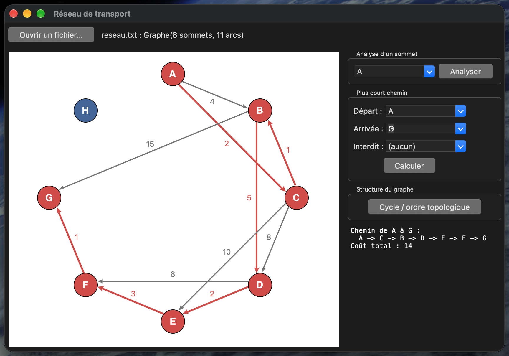

# Rapport – Concevoir et analyser un réseau de transport

Rémi Pierron · novembre 2026 · <https://github.com/remipierron/reseau_de_transport>

## 1. Introduction

Le réseau est modélisé par un **graphe orienté pondéré** G = (V, E) : les lieux sont les sommets, les liaisons des arcs `(origine, destination, poids)`. Toutes les parties sont réalisées (A à E, et les deux options du bonus F), avec la **bibliothèque standard** uniquement. Le code est testé avec Python 3.15, en local et en intégration continue (GitHub Actions).

## 2. Modèle orienté objet

Le paquet `graphe/` contient trois classes : `Sommet` (identifiant textuel non vide), `Arc` (origine, destination, poids validé à la construction) et `Graphe`, qui gère les sommets et les arcs, applique les règles de gestion et porte l'analyse et les algorithmes.

**Règles de gestion** vérifiées par `ajouter_sommet` et `ajouter_arc` : identifiant unique et non vide ; poids numérique ≥ 0 (nécessaire pour Dijkstra) ; extrémités déjà présentes ; `A → B` n'implique pas `B → A` ; sommet isolé valide. Les **arcs multiples sont interdits** (choix du sujet) : le doublon se juge sur le couple (origine, destination), quel que soit le poids.

**Exceptions personnalisées.** Toutes dérivent de `GrapheError`, ce qui permet d'intercepter toute erreur du modèle en une clause. Elles héritent aussi d'une exception standard quand c'est pertinent :

```
GrapheError
 +- IdentifiantInvalideError, PoidsInvalideError, LigneMalFormeeError  (+ ValueError)
 +- SommetInconnuError (+ KeyError), SommetExistantError, ArcExistantError
 +- GrapheCycliqueError (+ ValueError, attribut cycle)
 +- FichierGrapheError
     +- FichierIntrouvableError (+ FileNotFoundError)
     +- FormatFichierError (numéro et contenu de la ligne, cause d'origine)
```

**Séparation traitements / affichage.** Aucune méthode métier n'appelle `input()` ni `print()` : elles retournent des valeurs ou lèvent des exceptions. L'affichage est réservé à `demo.py` (ligne de commande) et `interface.py` (Tkinter).

## 3. Structures de données

| Attribut | Structure | Justification |
|---|---|---|
| `_sommets` | `dict` id → `Sommet` | Présence et doublons en O(1) ; ordre d'insertion conservé, donc résultats stables. |
| `_adjacence` | `dict` id → `dict` (destination → `Arc`) | Liste d'adjacence : test d'un arc en O(1), successeurs énumérés directement (Dijkstra, parcours). |
| `_entrants` | prédécesseurs de chaque sommet | Degré entrant et prédécesseurs sans parcourir tout le graphe ; réutilisé par le tri topologique. |

Une matrice d'adjacence coûterait O(|V|²) en mémoire pour un réseau peu dense.

## 4. Lecture de fichier et analyse

`Graphe.from_file(chemin)` lit une ligne `Sommets: A, B, C`, puis une ligne `origine;destination;poids` par arc (lignes vides et commentaires `#` ignorés). **Le fichier est rejeté en entier** à la première erreur : un réseau chargé à moitié donnerait des itinéraires faux sans que l'utilisateur le voie. L'exception indique le **numéro et le contenu de la ligne** fautive et garde l'erreur d'origine (`__cause__`) : `FichierIntrouvableError` pour un fichier absent, `FormatFichierError` pour une ligne mal formée, un poids non numérique ou négatif, ou un arc vers un sommet inconnu.

L'analyse (`analyser_sommet`, `degre_entrant`, `degre_sortant`, `degre_total`, `predecesseurs`, `successeurs`) retourne des copies exploitables. Sur `reseau.txt` : **H** a des degrés 0 / 0 / 0 et aucun voisin ; **B** a des degrés 2 / 2 / 4, prédécesseurs A, C et successeurs D, G ; **D** a des degrés 2 / 2 / 4, prédécesseurs B, C et successeurs E, F.

## 5. Plus court chemin (`shortest_path`)

**Principe de Dijkstra.** Une file de priorité (`heapq`) contient les sommets avec leur meilleur coût connu depuis le départ. On extrait à chaque tour le sommet de plus petit coût : ce coût devient **définitif**, puis on tente d'améliorer celui de ses successeurs. Un dictionnaire des prédécesseurs sert à reconstruire le chemin, et la recherche s'arrête dès que l'arrivée est extraite. Complexité : O((|V| + |E|) log |V|).

**Pourquoi il convient.** Les poids sont tous ≥ 0 (garanti par la validation). Tout autre chemin vers le sommet extrait passe par un sommet encore en file, de coût au moins égal, et ne peut qu'ajouter des poids positifs ou nuls : il n'est jamais moins cher. Avec des poids négatifs, il faudrait Bellman-Ford.

**Cas particuliers.** Départ = arrivée : `(["A"], 0)`. Aucun chemin : `([], math.inf)`, un résultat normal et non une exception, qui se teste par `if not chemin`. Sommet inconnu : `SommetInconnuError`. Les égalités de coût sont départagées par un compteur, d'où un résultat déterministe.

**Résultat A → G : `A → C → B → D → E → F → G`, coût 14** (2 + 1 + 5 + 2 + 3 + 1). L'arc direct `B → G` n'est pas retenu : il mènerait à un coût de 3 + 15 = 18.

## 6. Contraintes et comparaison

**`shortest_path_avoiding(depart, arrivee, interdit)`** réutilise la même méthode `_dijkstra`, qui saute les sommets exclus sans modifier le graphe. **Si l'interdit est le départ ou l'arrivée**, le résultat est `([], math.inf)` : un chemin contient toujours ses extrémités, donc aucun ne peut éviter ce sommet. On le traite comme « aucun chemin », par cohérence avec la partie D. Un interdit inconnu lève `SommetInconnuError` (probable faute de frappe).

| A → G | sans interdit | sans C | sans D | sans F | sans G |
|---|---|---|---|---|---|
| Chemin | A C B D E F G | A B D E F G | A C E F G | A C B G | aucun |
| Coût | 14 | 15 | 16 | 18 | ∞ |

**`intersection(autre_graphe)`** retourne un **nouveau** graphe : sommets communs, et arcs dont l'origine, la destination **et** le poids sont identiques. Il est construit avec ses propres objets, les graphes d'origine ne sont donc pas modifiés. Le second graphe `reseau2.txt` (sommets A, B, C, D, X ; 6 arcs, dont le cycle A → B → D → X → A) donne avec `reseau.txt` les sommets A, B, C, D et les arcs A → B (4), B → D (5), C → B (1). A → C n'est pas commun (poids 2 contre 3).

## 7. Bonus : cycle et ordre topologique

**`has_cycle()`** s'appuie sur `trouver_cycle()`, un parcours en profondeur à trois couleurs : blanc (non visité), gris (sur la branche en cours), noir (terminé). Atteindre un sommet **gris** revient à un ancêtre de la branche : cet arc ferme un cycle. Le parcours repart de chaque sommet blanc et il est **itératif**, donc sans `RecursionError` (testé sur 5 000 sommets).

**`topological_sort()`** suit l'algorithme de Kahn : on place les sommets sans prédécesseur, puis on décrémente le degré entrant de leurs successeurs (sur une copie) et on place ceux qui tombent à 0. S'il reste des sommets, c'est qu'il y a un cycle : la méthode lève `GrapheCycliqueError`, qui contient le cycle. Une liste vide aurait été ambiguë, car c'est l'ordre du graphe vide.

**Résultats.** `reseau.txt` est acyclique, ordre `A, H, C, B, D, E, F, G`. `reseau2.txt` contient le cycle A → B → D → X → A : aucun ordre n'existe.

{width=55%}

## 8. Tests et démonstration

**109 tests `unittest`, tous réussis** (`python3 -m unittest discover -s tests`, relancés à chaque push par GitHub Actions) : 17 pour la partie A, 18 pour B, 9 pour C, 15 pour D, 22 pour E et 28 pour F. Ils couvrent les huit tests obligatoires du sujet et les cas limites. Plusieurs comparent les résultats à une **recherche exhaustive** : tous les couples et triplets (départ, arrivée, interdit) des deux fichiers pour Dijkstra, et 300 petits graphes aléatoires (graine fixe) pour le tri topologique.

`python3 demo.py` montre les principales fonctionnalités ; sa sortie est enregistrée dans `exemples_execution.txt`. L'interface `interface.py` dessine le graphe et colore en rouge le chemin ou le cycle trouvé.

## 9. Limites connues

- **Un seul arc par couple** : deux liaisons parallèles (bus et train) ne sont pas modélisables.
- **Un seul sommet interdit**, alors que `_dijkstra` accepte déjà un ensemble ; un seul chemin retourné en cas d'égalité.
- **Pas de suppression** de sommet ou d'arc, ni d'enregistrement d'un graphe dans un fichier.
- **Rejet du fichier entier** : sûr, mais une seule erreur bloque tout le réseau.
- **Intersection** : poids comparés par égalité exacte, fragile pour des décimaux issus de calculs.
- **Interface** : placement en cercle peu lisible au-delà d'une vingtaine de sommets.

## 10. Ressources et assistance par IA

Documentation officielle de Python (`heapq`, `unittest`, `pathlib`, `tkinter`). Claude Code (Opus 5.5, Sonnet 5.5) a servi à comprendre le sujet, planifier le projet, aider au développement et aux tests, et vérifier la conformité aux consignes (détail par partie dans le README). J'ai relu, exécuté et testé l'ensemble du code, et je suis en mesure de l'expliquer et de le modifier.